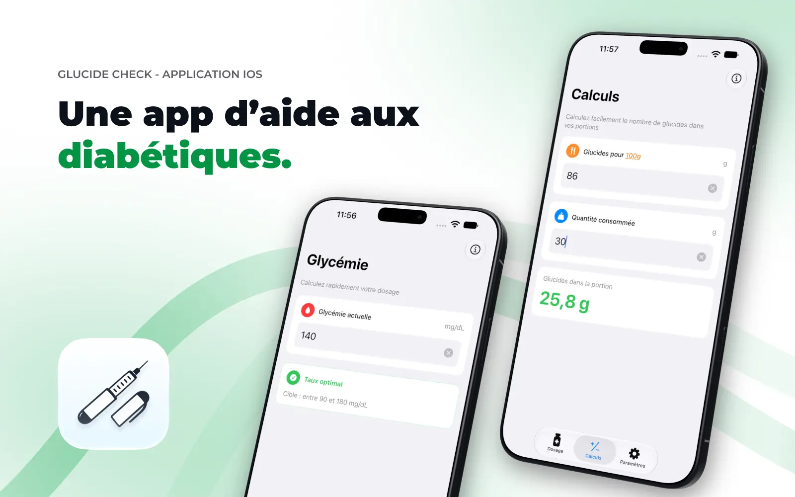

# Glucide-Check

  

Glucide-Check est une application iOS native développée en Swift pour aider les personnes diabétiques. Ce projet a été ma première expérience en développement mobile natif, conçue comme un outil pratique pour le suivi de la glycémie.

## Fonctionnalités
L'application est organisée en trois onglets principaux, chacun dédié à une fonction utile pour gérer la glycémie :

### 1. Calculateur d'insuline
Le premier onglet permet de saisir la glycémie actuelle et de calculer le nombre d'unités d'insuline nécessaires pour atteindre un taux optimal. En cas d'hypoglycémie, l'application estime aussi le nombre de carrés de sucre à prendre pour remonter la glycémie.

### 2. Calcul en croix
Le deuxième onglet propose un outil de calcul en croix pour estimer les glucides d'une portion. On indique les glucides pour 100 g (ou une autre référence) et la quantité consommée, puis l'application calcule les glucides de la portion.

### 3. Paramètres
Le troisième onglet sert à la configuration. On peut y renseigner des informations personnelles (prénom, date de naissance, genre, poids) et définir des paramètres médicaux personnalisés : influence de l'insuline, effet d'un carré de sucre, et cible de glycémie (minimum et maximum). L'application propose aussi le choix du mode sombre (clair, sombre ou système) et le changement de langue.

## Points forts du développement
Glucide-Check illustre mon apprentissage du développement mobile natif et ma capacité à concevoir une solution concrète et utile. Ce projet m'a permis d'explorer les fonctionnalités iOS et de progresser avec Swift.

## Technologies utilisées
- Swift
- Xcode
- UIKit / SwiftUI
- Core Data
